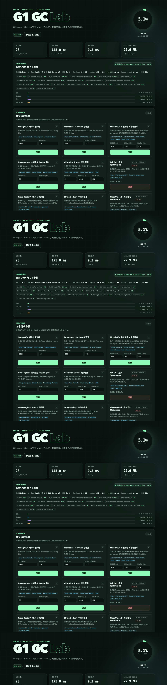

# G1 GC Lab · JDK 21

一个以 **Spring Boot 3.5 + JDK 21 + G1** 为主题的教学实验项目：用真实 HTTP 请求触发不同 GC 场景，实时查看 JVM / 堆 / GC 参数与事件，并直接 tail JVM 生成的 unified GC 日志。

> 默认堆 **2G**，但堆大小可以是**任意值**：`HEAP=1536m`、`HEAP=3g` 都行，启动脚本会校验输入并按公式预告该堆下的 Region 与 Humongous 阈值（见下文）。



## 这个项目能做什么

- 9 个实验场景：Young、Promotion、Mixed、Humongous、Allocation Storm、Full GC、跨 Region 引用、String Dedup、Class Unload，以及一个 Reset。
- 浏览器控制台：**GC 暂停时间线 SVG 图**（按类型着色 + 分类型统计）、GC 事件表、堆组成、G1 参数、retained 数据、GC 日志 tail。
- **解析器 v2**：除 pause 汇总行外，还聚合 info 级的 Region 转移行（Eden/Survivor/Old/Humongous）、并发周期（Concurrent Mark Cycle / Scan Root Regions / Clear Claimed Marks / Cleanup for Next Mark）、暂停阶段分解（Pre/Evacuate/Post Evacuate Collection Set、Merge Heap Roots、Full GC Phase 1-4）、User/Sys/Real 并行度、Metaspace 变化；verbose 级额外提取自适应 IHOP、ergo 决策（如 `do not continue mixed GCs`）、tenuring 阈值、引用处理统计、Humongous Reclaimed、PLAB、卡表/refinement——全部进事件的 `regionTransitions/phases/cpu/metaspace/details` 字段。
- **场景一手证据闭环**：string-dedup 响应直接返回 new/deduped/平均去重率；class-unload 响应返回实际卸载的类数量（来自 stringdedup / class-unload 侧日志）。
- **运行历史与 A/B 对比**：服务端保留最近 20 次运行，控制台勾选两条做单变量对比——调优工作坊的核心闭环。
- **进度与协作式取消**：长场景（mixed-gc）显示阶段进度，可随时取消并保留部分证据；所有场景有真实的墙钟预算上限。
- **JFR 飞行记录**：控制台一键 start/stop/status，落盘 logs/ 并可直接下载（JDK 内置 FlightRecorder，零依赖）。
- 覆盖 G1 架构、参数、日志、JFR/jcmd、故障模式与调优的中文文档。
- 一条命令生成可复现的真实 GC 日志样例；**实验结束后一条命令清除全部残留**（`./scripts/cleanup.sh`）。
- 学习路线与调优工作坊：从 Region 直觉到单变量 A/B 实验，而不只是点击按钮。

## 快速开始

要求：JDK 21、Maven（项目自带 Maven Wrapper）。

```bash
# 2G（默认）
./mvnw clean package
./scripts/run.sh

# 4G（环境变量前缀写法）
HEAP=4g ./scripts/run.sh

# 任意堆 + 参数后置写法（两种写法等价，参数优先级更高）
./scripts/run.sh --heap 1536m --profile low-latency --skip-build
./scripts/run.sh -h    # 查看全部选项

# 打开控制台
open http://127.0.0.1:8080
```

`run.sh` 会打印完整的 Java 启动命令。GC 参数只能通过 JVM 启动参数传入，不能写在 `application.yml` 中。**默认堆的优先级**：`--heap`/`HEAP` 环境变量 > `scripts/heap.conf`（复制 `scripts/heap.conf.example` 而来，可固定你的常用堆）> 内置 2g。脚本会拒绝非法值与 <512m 的堆，对小堆（<1G）和超过物理内存一半的堆给出警告。

如果所在环境无法下载 Maven Wrapper，可显式使用本机 Maven：`MAVEN_CMD=mvn ./scripts/run.sh`。

常用 profile：

```bash
PROFILE=jdk-defaults ./scripts/run.sh   # 尽量贴近 JDK 默认 ergonomics
PROFILE=low-latency ./scripts/run.sh    # 4G、50ms pause target
PROFILE=throughput ./scripts/run.sh     # 4G、500ms pause target
PROFILE=humongous ./scripts/run.sh      # 4m region，放大 Humongous 实验
PROFILE=verbose ./scripts/run.sh        # gc*=debug，供日志分析
```

也可以强制 Region 大小做对照：

```bash
REGION_SIZE=1m HEAP=4g ./scripts/run.sh
REGION_SIZE=4m HEAP=2g ./scripts/run.sh
```

## 默认实验参数

```text
-Xms2g -Xmx2g
-XX:+UseG1GC
-XX:MaxGCPauseMillis=100
-XX:InitiatingHeapOccupancyPercent=30
-XX:MaxTenuringThreshold=3
-XX:+UseStringDeduplication -XX:StringDeduplicationAgeThreshold=1
-XX:+UnlockExperimentalVMOptions
-Xlog:gc*=info:file=logs/gc-%t.log:utctime,uptime,level,tags:filecount=10,filesize=20m
```

其中 pause target、IHOP、tenuring、string dedup 都是为了让课堂演示更快出现相应现象，**不是 G1 的 JDK 默认值**。默认值见 [02-g1-flags.md](docs/02-g1-flags.md)。

默认不设置 `G1HeapRegionSize`。Region 大小由公式推导（`run.sh` 启动时按此预告，实际值见 `/api/config`）：

```text
region = 堆大小 ÷ 2048，向上取整到 2 的幂，夹在 [1M, 32M]
Humongous 阈值 = region ÷ 2
```

常用堆的对照（启动脚本对任意堆都会打印同样的预告）：

| 堆 | 自动 Region 大小 | Region 数 | Humongous 阈值 |
|---|---|---|---|
| 512m ~ 2G | 1M | 堆÷1M（512~2048） | 约 512KB |
| 3G | 2M | 1536 | 约 1MB |
| 4G | 2M | 2048 | 约 1MB |
| 6G | 4M | 1536 | 约 2MB |
| 8G | 4M | 2048 | 约 2MB |
| 12G | 8M | 1536 | 约 4MB |

注意 6G/12G 这类”非整 2G 档”的堆：region 取 2 的幂会向上跳档（6G÷2048=3M→4M），Region 数反而少于 4G 堆——这正是 ergonomics 的非线性所在，本身就是实验素材。

Region 大小不是”越大越好”，它直接改变 Humongous 门槛、RSet 粒度和碎片形态。

## 场景

| 场景 | 默认量级 | 主要观察 |
|---|---|---|
| `young-gc` | 约 1.2GB 短命分配 | `Pause Young (Normal)`、Eden 回收 |
| `promotion` | 256MB retained + 512MB churn | Survivor / Old 增长、晋升 |
| `mixed-gc` | 409MB dead + 204MB live + 压力 | Concurrent Start → Mark → Remark → Cleanup → Mixed |
| `humongous` | 32 × 2MB（2G/1M region） | Humongous regions、H 碎片 |
| `allocation-storm` | 4 线程 × 目标 10s | 连续 Young GC、暂停分布 |
| `full-gc` | `System.gc()` | `Pause Full`、Phase 4: Compact heap |
| `cross-region` | 25 万节点引用图 | Remembered Sets / Scanned Cards / refinement |
| `string-dedup` | 3 万 × 512 字符 | String Deduplication（独立日志） |
| `class-unload` | 500 个动态类 | class unload、Metaspace |
| `reset` | 清空 retained | 复位实验环境 |

页面会按当前堆大小给出建议参数；所有场景串行执行，高风险按钮会在接口层再次检查。

## 常用 API

场景请求体是**按场景命名的参数 map**：`{"参数名": 整数}`。参数名与 min/max 范围见 `GET /api/scenarios`；未知参数、越界值返回 400 并附可用参数提示（前端卡片本来就是按 ParamSpec 动态渲染的，无感切换）。

```bash
curl -s http://127.0.0.1:8080/api/status | jq .
curl -s http://127.0.0.1:8080/api/scenarios | jq .
curl -s -X POST http://127.0.0.1:8080/api/scenarios/young-gc/run \
  -H 'Content-Type: application/json' -d '{}'
curl -s -X POST http://127.0.0.1:8080/api/scenarios/mixed-gc/run \
  -H 'Content-Type: application/json' -d '{"deadMb":409,"liveMb":204,"finalChurnMb":614}'
curl -s -X POST http://127.0.0.1:8080/api/scenarios/current/cancel   # 取消当前场景
curl -s http://127.0.0.1:8080/api/scenarios/history | jq .           # 运行历史（A/B 对比）
curl -s http://127.0.0.1:8080/api/logs | jq .
curl -s 'http://127.0.0.1:8080/api/logs/tail?name=gc-xxx.log&lines=100'
curl -s -X POST http://127.0.0.1:8080/api/jfr/start -H 'Content-Type: application/json' -d '{"seconds":30}'
curl -s http://127.0.0.1:8080/api/jfr/status | jq .
```

| 方法 | 路径 | 说明 |
|---|---|---|
| GET | `/api/status` | JVM、堆、GC、Region、日志源、最近事件、场景进度、侧日志证据 |
| GET | `/api/config` | 关键 G1 flag 与启动参数 |
| GET | `/api/scenarios` | 场景参数契约（参数名/默认值/min/max/预期日志） |
| POST | `/api/scenarios/{id}/run` | 执行场景（请求体为按场景命名的参数 map） |
| POST | `/api/scenarios/current/cancel` | 协作式取消当前场景 |
| GET | `/api/scenarios/history` | 最近 20 次运行（含已取消） |
| POST | `/api/scenarios/reset` | 清空 retained，可选显式 GC（`?gc=false`） |
| GET | `/api/gc/events?afterSeq=&limit=` | 增量事件（含 v2 富字段） |
| GET | `/api/logs` | 日志/JFR 文件列表 |
| GET | `/api/logs/tail` | 安全 tail（仅 .log） |
| GET | `/api/logs/download` | 下载 .log / .jfr（防路径穿越） |
| POST | `/api/jfr/start` · `/api/jfr/stop`，GET `/api/jfr/status` | JFR 录制（上限 `demo.max-jfr-seconds`） |
| GET | `/actuator/health` / `/actuator/metrics` | 健康检查 / JVM 指标 |

接口绑定 `127.0.0.1`，默认没有鉴权，**不要暴露到公网**。

## 学习与调优

```bash
# 学习路线（先读文档，再按模块操作）
open docs/10-g1-learning-path.md

# 多 profile 单变量 A/B：保存每个 profile 的日志、响应和统计
./scripts/tuning-lab.sh allocation-storm

# 只对比两个 profile
PROFILES="jdk-defaults low-latency" ./scripts/tuning-lab.sh young-gc
```

A/B 结果写入 `reports/tuning-<timestamp>/`，不会修改 `docs/samples/`。

## 生成日志样例

```bash
./scripts/generate-sample-logs.sh
./scripts/analyze-gc-log.sh logs/gc-xxxx.log
```

第一条命令会启动 2G 实例跑完整场景，再启动 4G 实例做对比，并把裁剪后的真实日志写入 `docs/samples/`。完整日志在 `logs/`（已 gitignore）。

## 文档索引（11 篇，按用途分组）

**上手操作**

| 文档 | 内容 |
|---|---|
| [04-scenario-playbook.md](docs/04-scenario-playbook.md) | 场景操作唯一手册：每个场景的参数、预期与观察点 |
| [08-reproduction-runbook.md](docs/08-reproduction-runbook.md) | 从零复现：环境、构建、启动、4G 对照、验收清单 |

**参考知识**

| 文档 | 内容 |
|---|---|
| [01-g1-internals.md](docs/01-g1-internals.md) | G1 内部机制：第一部分概念模型（Region/RSet/SATB/周期），第二部分全流程与数据结构深潜（TAMS/Bitmap/Mark Stack） |
| [02-g1-flags.md](docs/02-g1-flags.md) | JDK 21 G1 参数表、堆与 Region 推导公式、调优顺序 |
| [05-tuning-and-troubleshooting.md](docs/05-tuning-and-troubleshooting.md) | 症状驱动的排障手册 |
| [06-tools-and-observability.md](docs/06-tools-and-observability.md) | JMX、JFR、jcmd、jstat、actuator |

**证据解读**

| 文档 | 内容 |
|---|---|
| [03-gc-log-analysis.md](docs/03-gc-log-analysis.md) | 第一部分按主题读日志，第二部分样例文件逐份分析 |

**实践路径**

| 文档 | 内容 |
|---|---|
| [10-g1-learning-path.md](docs/10-g1-learning-path.md) | 10 个学习模块、7 天安排与自测题 |
| [11-g1-tuning-workshop.md](docs/11-g1-tuning-workshop.md) | 调优方法论、A/B 实验和工作簿 |

**档案与索引**

| 文档 | 内容 |
|---|---|
| [00-coverage-matrix.md](docs/00-coverage-matrix.md) | G1 核心知识面覆盖矩阵（知识点 × 项目落点） |
| [07-implementation-journal.md](docs/07-implementation-journal.md) | 开发档案：实现步骤、实际命令、踩坑与修复记录 |

阅读路径（三条主线）：

1. **第一次跑**：[08 复现手册](docs/08-reproduction-runbook.md) 起步 → 场景操作查 [04 手册](docs/04-scenario-playbook.md) → 日志看不懂查 [03 日志解读](docs/03-gc-log-analysis.md)。
2. **系统学习 G1**：[01 内部机制](docs/01-g1-internals.md)（先概念卡后深潜）→ 按 [10 学习路线](docs/10-g1-learning-path.md) 做实验 → 用 [11 调优工作坊](docs/11-g1-tuning-workshop.md) + `scripts/tuning-lab.sh` 练单变量 A/B。
3. **排查具体问题**：[05 排障手册](docs/05-tuning-and-troubleshooting.md) 按症状定位 → 工具细节查 [06 工具链](docs/06-tools-and-observability.md)。

## 项目结构

```text
src/main/java/com/example/gcdemo/
├── gc/          GC 日志解析 v2（pause 汇总 + Region/并发周期/阶段分解/verbose 细节）、
│                GC(n) 聚合器、事件存储、侧日志证据（stringdedup/class-unload）、
│                JFR 录制、JVM/堆/统计观测
├── memory/      retained 引用、内存 guard（含堆水位检查）、分配工具
├── scenario/    场景框架（按场景命名参数 + 进度/取消/墙钟预算上下文）、
│                运行历史、10 个实现
├── web/         REST API、ProblemDetail 错误处理
└── config/      demo.* 配置

scripts/
├── run.sh                    启动、profile、JVM flags（含 JDK 21 预检）
├── analyze-gc-log.sh         暂停统计与异常关键字
├── generate-sample-logs.sh   2G/4G 实验与日志样例（CLEANUP=1 自动收尾）
├── tuning-lab.sh             多 profile 单变量 A/B 实验台
└── cleanup.sh                结束清理：清除所有运行残留（logs/、reports/、.DS_Store、/tmp 临时目录）
```

## 实验结束后清理（必读）

任何实验、冒烟测试或开发会话结束后，运行结束脚本清除所有无关的残留数据与日志文件：

```bash
./scripts/cleanup.sh              # 清除 logs/*、reports/tuning-*、.DS_Store、/tmp 残留
./scripts/cleanup.sh --dry-run    # 先看将删除什么，不实际执行
./scripts/cleanup.sh --all        # 连 target/ 构建产物一起清
./scripts/cleanup.sh --keep-reports  # 保留 A/B 实验报告，只清其余
```

- **不动**：`docs/samples/`（提交样例）、源码、`target/`（除非 `--all`）；
- 白名单 glob 删除，幂等可重复；`generate-sample-logs.sh` 支持 `CLEANUP=1` 自动收尾；
- `tuning-lab.sh` 的报告是实验交付物，结束时只提示、不自动清理。

## 安全与实验边界

- 默认 `-Xms=Xmx=2g`；4G 需显式设置。
- retained 强引用上限为 `min(768MB, 40% 堆)`；分配前还会做**堆水位检查**（当前已用 + 存活峰值 > 92% 堆即拒绝，提示先 reset）。
- 单场景分配、线程数有上限；**两类时长上限**：`demo.max-duration-ms`（15s）约束请求参数（如 allocation-storm 的 durationMs），`demo.max-scenario-wall-ms`（默认 90s）是场景整体的墙钟预算——mixed-gc 内部的多阶段等待链路也受它约束，这是"场景时长上限"声明的真实边界。
- 场景串行执行，可随时**协作式取消**（`POST /api/scenarios/current/cancel`），取消后返回已发生的部分证据。
- `System.gc()` 只出现在明确标注的 Full GC、Class Unload、Reset 场景中。
- 日志 tail 只允许读取 `logs/` 下的 `.log` basename，防路径穿越；下载端点同守卫并扩展 `.jfr`。

## JDK 21 注意事项

- G1 自 JDK 9 起是默认 GC；本项目仍显式写 `-XX:+UseG1GC`。
- `G1NewSizePercent`、`G1MaxNewSizePercent`、`G1MixedGCLiveThresholdPercent`、`G1OldCSetRegionThresholdPercent` 在 JDK 21 是 **experimental**，需要 `-XX:+UnlockExperimentalVMOptions` 才能读取或设置；启动脚本已包含该开关。
- GC 日志格式以 JDK 21 Unified Logging 为准；不同 JDK 版本的并发阶段行可能略有差异。
